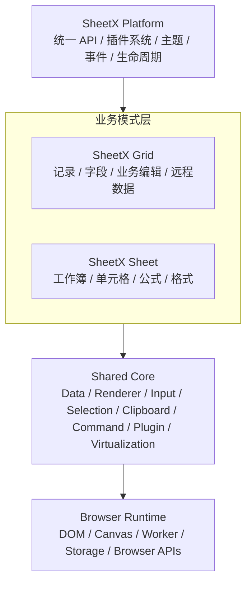

# 架构总览

SheetX 是一个**嵌入式表格运行时**，而不是简单"用 Canvas 画表格"。它拥有自己的数据模型、渲染调度、编辑系统、交互系统、公式计算系统和插件体系。

## 分层模型



- **平台层**：对外稳定 API、事件、主题、插件与生命周期。
- **模式层**：Grid 与 Spreadsheet 并列，共用内核但拥有独立产品能力。
- **共享内核**：12 个核心子系统（数据、网格布局、渲染、输入、选择、编辑、剪贴板、命令、校验、公式、插件、数据适配器）。
- **浏览器运行时**：DOM / Canvas / Worker / 存储。

## 关键设计原则

1. **核心引擎不依赖任何前端框架**；框架适配层在最外层。
2. **双模式但不是两个产品**：共享选择、键盘、渲染、撤销重做，但不强行统一数据结构。
3. **数据模型必须不同**：
   - Grid 以业务记录为中心（一行 = 一条业务记录，可有 100 万条）。
   - Sheet 以工作簿 / 稀疏单元格为中心（只存非空单元格）。
4. **数据更新不能触发整表重算 / 重绘**：变更用 Patch / Operation 表达，脏区域渲染，公式增量调度。
5. **API 稳定、模块解耦、插件化**：公式引擎与渲染引擎可单独升级。

## 主线程与 Worker

| 线程 | 职责 |
|---|---|
| 主线程 | DOM / 事件 / 输入法 / 焦点 / 编辑器 / 菜单 / API |
| 渲染 Worker | Canvas 绘制、文本缓存、视口刷新（可选，能力检测降级） |
| 计算 Worker | 公式计算、排序、筛选、聚合（内联 Worker，零构建产物） |

纪律：**不在 Worker 与主线程间传递完整数据表**，只传任务 + 增量补丁 + revision；无 Worker 环境必须有主线程降级。详见 [并行计算](/advanced/worker) 与 [后台渲染](/advanced/offscreen)。

## 依赖方向（单向，不成环）

```
适配层 (web-component / vue / react)
   → 模式层 (grid / spreadsheet)
      → 引擎层 (data / renderer / interaction / editors / formula / validation / data-adapter / io / worker / themes)
         → core (零依赖：types / command / event / plugin / renderer / lifecycle)
```

`core` 不依赖 `grid`、`spreadsheet`、`vue`、`react`；渲染器通过接口提供能力，不直接依赖业务模式的数据结构。

## 下一步

- [双模式：Grid 与 Spreadsheet](/guide/dual-mode)
- [包地图与依赖方向](/guide/packages)
- [渲染管线与脏矩形](/advanced/rendering)
